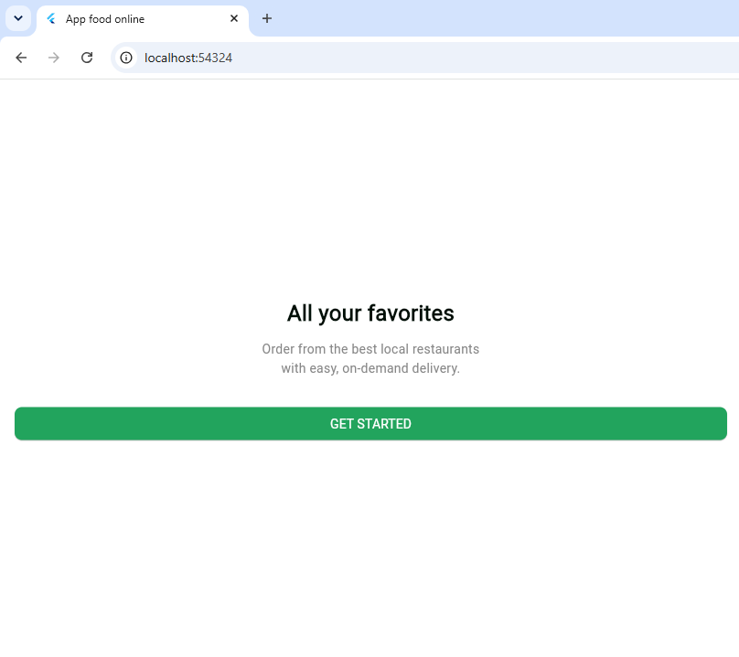
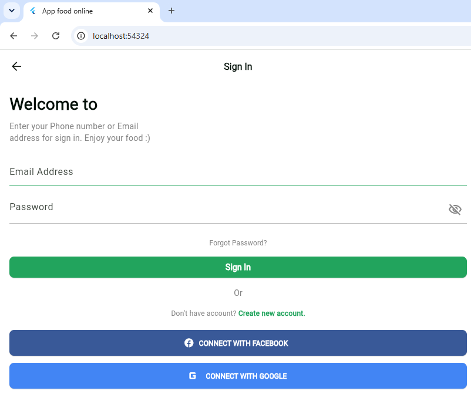
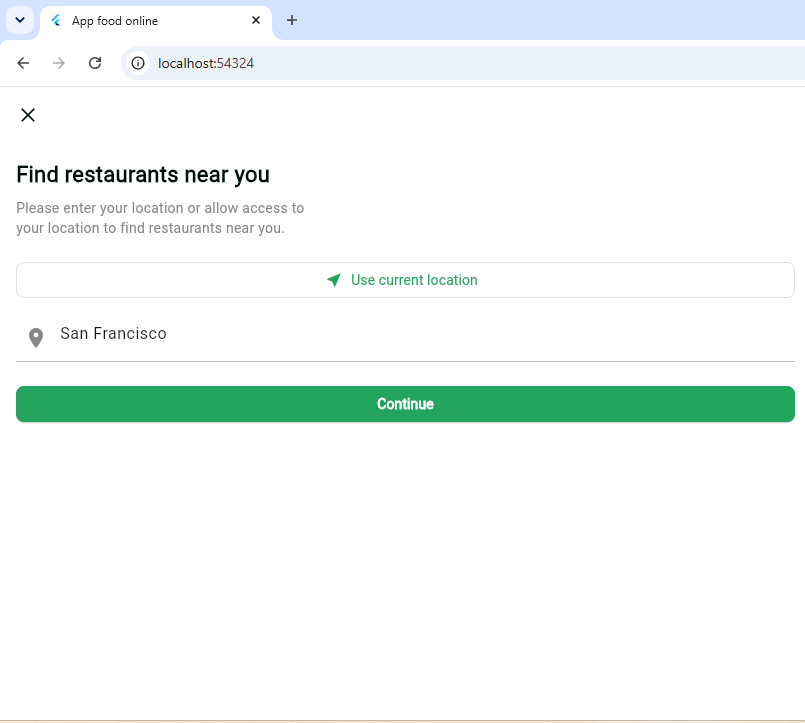
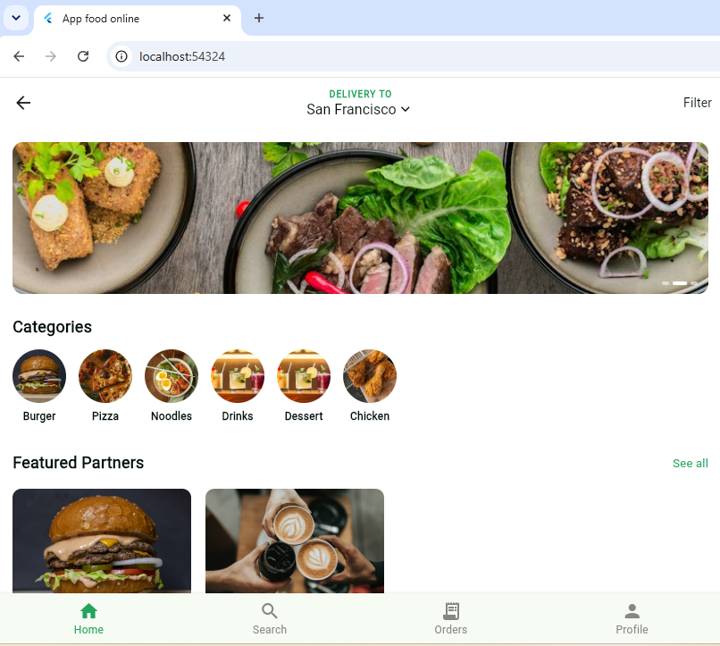
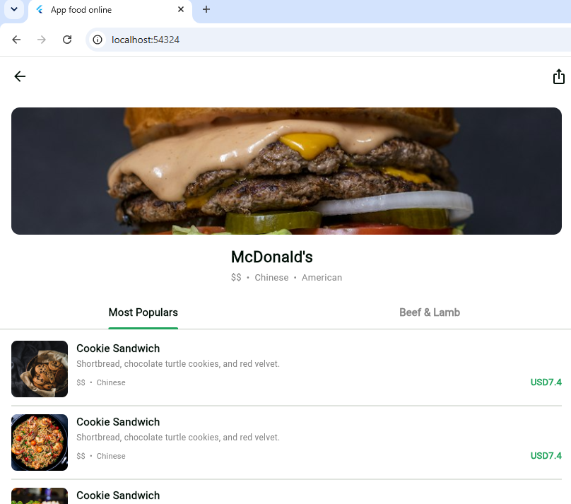

# 🍔 Food Online App

Aplikasi seluler dan web pemesanan makanan (*Food Delivery*) interaktif berbasis **Flutter**. Aplikasi ini dirancang dengan antarmuka yang modern, responsif, dan kaya fitur untuk memudahkan pengguna mencari restoran lokal, memilih kategori makanan, hingga melacak pesanan dengan mudah.

---

## ✨ Fitur Utama
- **Onboarding & Authentication:** Halaman perkenalan aplikasi serta fitur *Sign In* yang bersih dan intuitif.
- **Auto-sliding Banner:** Banner promosi utama di halaman beranda yang bergeser secara otomatis.
- **Dynamic Food Categories:** Galeri kategori makanan interaktif berbentuk gambar melingkar (Burger, Pizza, Noodles, dll).
- **Featured Partners:** Daftar restoran mitra pilihan lengkap dengan informasi rating, waktu pengiriman, dan layanan antar gratis.
- **Bottom Navigation Bar:** Navigasi bawah untuk beralih antar halaman (Home, Search, Orders, Profile).

---

## 📸 Tampilan Aplikasi (*Screenshots*)

Berikut adalah beberapa cuplikan tampilan dari aplikasi **Food Online**:

| Halaman Onboarding | Halaman Sign In | Lokasi |
| :---: | :---: | :---: |
|  |  |  |

| Kategori | Menu |
| :---: | :---: |
|  |  |

---

## 🛠️ Teknologi yang Digunakan
- **Framework:** Flutter (Dart)
- **Platform Target:** Android, iOS, Web (Chrome), & Desktop (Windows)
- **State Management:** StatefulWidget & PageController
- **Package Pendukung:** `async` (untuk pengatur waktu banner otomatis)

---

## 🚀 Cara Menjalankan Project

1. Pastikan Flutter SDK sudah terinstal di komputer Anda.
2. Clone repository ini:
   ```bash
   git clone [https://github.com/username-abang/aplikasi-food-online.git](https://github.com/username-abang/aplikasi-food-online.git)